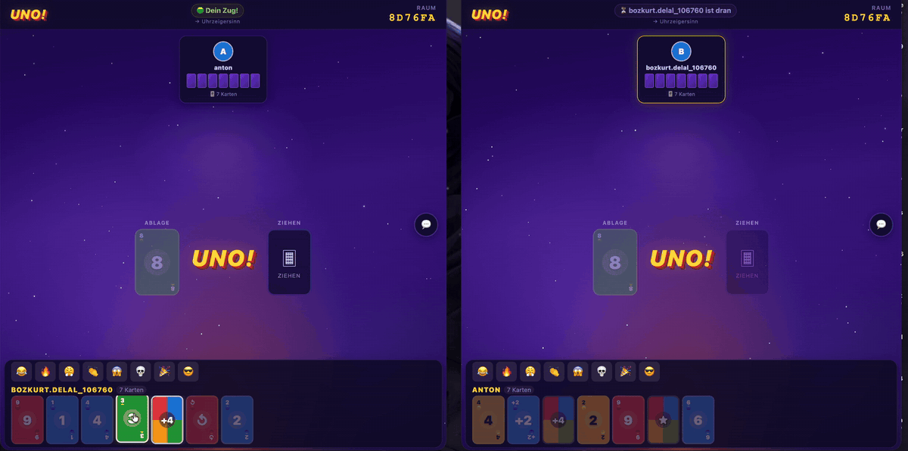
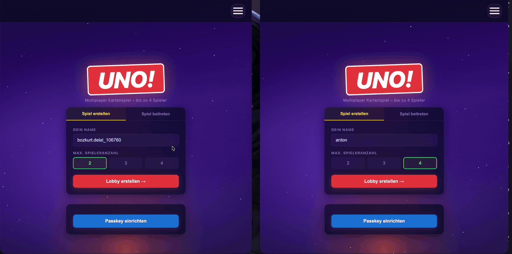

# UNO! Multiplayer-Kartenspiel

Dieses bekannte Kartenspiel für bis zu 4 Spieler in Echtzeit entstand im Rahmen einer dreiköpfigen Gruppenarbeit im Wahlpflichtfach **Webtechnologien** an der **Hochschule RheinMain** im Sommersemester 2026.

Das Projekt beinhaltet eine Anmeldung bzw. Registrierung (klassisch mit E-Mail und Passwort oder bequem per Google-Login und Passkeys), eine Lobbyansicht, das Spielen selbst, einen Chat und Emoji-Reaktionen.



---

## Gruppenprojekt

Das Projekt wurde zu dritt entwickelt. Ich war für das **Frontend** (Vue 3) verantwortlich. Das Backend mit der Spiellogik hat ein Teammitglied umgesetzt, den Registrierungs- und Authentifizierungsteil wiederum ein anderes Teammitglied.

**Mein Beitrag:**

- Anbindung an das Backend: Spielstände per **GraphQL**, Live-Updates (Karten, Zugwechsel, Chat usw.) per **WebSocket**
- WebSocket-Client als **Singleton** mit Auto-Reconnect, genutzt von allen Views
- Umsetzung als **Progressive Web App** (installierbar, offlinefähig, vom Professor gefordert)

> **Hinweis:** Das Projekt wurde ursprünglich im GitLab der Hochschule entwickelt. Dieses Repository ist eine Kopie für mein Portfolio, die ursprüngliche Commit Historie ist daher hier nicht enthalten.

---

##  Features

- **Echtzeit-Multiplayer** für 2–4 Spieler über WebSockets
- **Lobby-System** mit Raum-Code zum Beitreten
- **Chat und Emoji-Reaktionen** während des Spiels
- **Drei Login-Möglichkeiten:**
  - klassisch mit E-Mail und Passwort (bcrypt, JWT)
  - **Google-Login** über OpenID Connect
  - **Passkeys** (WebAuthn), Anmeldung ohne Passwort
- **Progressive Web App:** im Browser installierbar und offline-fähig
- **REST- und GraphQL-API** inklusive Subscriptions
- API-Dokumentation mit OpenAPI/Swagger
- Admin-Bereich



---

## Projekteigenschaften

| Bereich | Technologien |
|---------|--------------|
| Frontend | Vue 3, Vite, PWA (Service Worker, Web App Manifest) |
| Backend | Node.js, Express, Apollo Server (GraphQL), WebSockets |
| Datenbanken | MongoDB (Spieldaten, via Docker), SQLite (Benutzerkonten) |
| Authentifizierung | JWT, bcrypt, OpenID Connect (`openid-client`), WebAuthn (`@simplewebauthn`) |
| Testing | Jest |

---

## Projekt lokal starten

### Voraussetzungen
- Node.js 20 oder neuer
- Docker (für MongoDB)

### 1. MongoDB starten
```bash
docker-compose up -d
```

### 2. Umgebungsvariablen anlegen
```bash
cp backend/.env.example backend/.env
```
Danach in `backend/.env` die Werte eintragen (siehe [Google-Login einrichten](#google-login-einrichten-optional)).
Die SQLite-Datenbank `backend/users.db` wird beim ersten Start automatisch angelegt.

### 3. Backend starten
```bash
cd backend
npm install
npm start
```

### 4. Frontend starten
In einem zweiten Terminal im Projektordner:
```bash
cd frontend
npm install
npm run dev
```
Die App läuft dann unter **http://localhost:5173**.

### Als PWA bauen (optional)
```bash
cd frontend
npm run build
npm run preview
```
Unter http://localhost:4173 erscheint im Browser ein „Installieren“-Button in der Adressleiste.

### Tests ausführen
```bash
cd backend
npm test
```

---

## Google-Login einrichten (optional)

Der Login mit E-Mail und Passwort funktioniert ohne weitere Einrichtung. Für den Google-Login wird ein eigener OAuth-Client benötigt:

1. In der [Google Cloud Console](https://console.cloud.google.com) ein Projekt anlegen.
2. Unter **Google Auth Platform** die Zielgruppe „Extern“ wählen und das eigene Google-Konto als **Testnutzer** eintragen.
3. Einen Client vom Typ **Webanwendung** erstellen mit der Weiterleitungs-URI
   `http://localhost:3000/auth/google/callback`
4. Client-ID und Client-Secret in `backend/.env` eintragen.

---

##  Endpunkte

| Dienst | URL |
|--------|-----|
| REST API | http://localhost:3000/lobby |
| Auth (REST) | http://localhost:3000/auth |
| GraphQL | http://localhost:3000/graphql |
| Game WebSocket | ws://localhost:3000/game |
| GraphQL Subscriptions | ws://localhost:3000/subscriptions |
| API-Dokumentation | http://localhost:3000/api-docs |

### WebSocket-Nachrichten
Spiel und Chat laufen über `ws://localhost:3000/game`. Beispiel:
```json
{
  "type": "CHAT_MESSAGE",
  "payload": { "roomCode": "ABC123", "playerName": "Max", "text": "Hallo!" }
}
```
Weitere Typen: `JOIN_LOBBY`, `START_GAME`, `PLAY_CARD`, `DRAW_CARD`